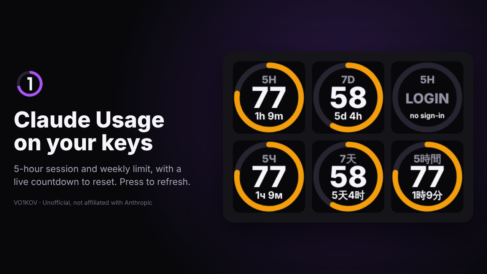

# VO1KOV Claude Usage

Live Claude usage limits on Stream Dock keys: the 5-hour session limit and the weekly limit, each with a ring gauge, the percentage used and a countdown to the reset.

*Unofficial, not affiliated with Anthropic.*

## Actions

| Action | What it shows |
|---|---|
| 5-hour session | Current session limit (`5H`) |
| Weekly limit | 7-day limit (`7D`) |
| Model weekly limit | Per-model weekly limit, if the plan reports one (`--` otherwise) |
| All in one key | Press to switch between session, week and model |

The ring is purple below 50%, amber from 50% and red from 80%. Data refreshes every minute; pressing a key refreshes immediately.

## Requirements

- Windows 10 or newer
- Stream Dock 3.10.188.226 or newer (uses the built-in Node 20, `"Nodejs": {"Version": "20"}`)
- Claude Code installed and signed in on the same PC: run `claude` once and log in

## How it works

- Reads the Claude Code OAuth sign-in from `%USERPROFILE%\.claude\.credentials.json` (or `CLAUDE_CONFIG_DIR`).
- Calls Anthropic's usage endpoint once a minute, shared by all keys.
- When the access token expires, refreshes it the same way Claude Code does and writes the rotated token back, so Claude Code stays signed in.
- No analytics, no third-party servers, no external npm dependencies (a minimal WebSocket client is built in).
- Key images are drawn as SVG at runtime.

The usage endpoint is undocumented and may change.

## Languages

English, 简体中文, Русский, Deutsch, Français, Español, 日本語, 한국어 — taken from the Stream Dock language setting, both for action names and for the text on the keys.

## Tested on

MRSVI / MiraBox N3-type device (6 LCD keys, 3 knobs), Windows 11.

## Credits

Token and usage-endpoint handling follows the approach of [claude-usage-streamdeck-plugin](https://github.com/saeedkolivand/claude-usage-streamdeck-plugin) by Saeed Kolivand (MIT).

Author: VO1KOV — [github.com/sergvo1kov](https://github.com/sergvo1kov)
