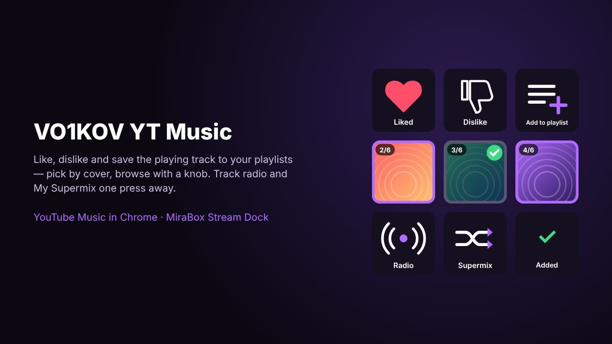

# VO1KOV YT Music

Control YouTube Music in Chrome from your MiraBox Stream Dock: like, dislike, save the playing track to your playlists (pick by cover, browse with a knob), start track radio and My Supermix.

## Actions

| Action | Controller | What it does |
|---|---|---|
| **Like** | Key | Like / remove like for the current track. The heart turns red when the track is liked. |
| **Dislike** | Key | Dislike / remove dislike. |
| **Add to playlist** | Key | Press: shows your playlists with their covers. Press again: adds the track. A check mark means the track is already there. Two quick presses add to the last used playlist. |
| **Browse playlists** | Knob | Turn: browse playlists on the *Add to playlist* key. Press: add the track. |
| **Track radio** | Key | Starts radio based on the current track. |
| **My Supermix** | Key | Plays My Supermix. |

Play/pause and next/previous are left to Stream Dock's built-in Multimedia actions.

## Setup

The plugin talks to YouTube Music through a small Chrome extension that ships inside the plugin folder.

1. Install the plugin.
2. Open `chrome://extensions`, turn on **Developer mode**, click **Load unpacked** and select
   `%APPDATA%\HotSpot\StreamDock\plugins\com.vo1kov.ytmusic.sdPlugin\chrome-extension`
3. Reload YouTube Music (a tab or the installed YouTube Music app).

Until the extension is connected, the keys show **not linked**. Pressing one opens a setup page with these steps and copy buttons.

Works in Chrome, Edge and other Chromium browsers, including the installed YouTube Music app (PWA).

## How it works

- The plugin listens on `ws://127.0.0.1:39871` (localhost only). The extension's background service worker connects to it — not the web page, because Chrome's Local Network Access blocks public sites from reaching `127.0.0.1`. Connections from other web origins are rejected.
- Like/dislike click the player's own buttons. Playlists, covers, adding a track, radio and Supermix use YouTube Music's own web API from inside the open page, with the session you are already signed in with.
- Covers are downloaded by the plugin and drawn on the key.
- Built-in Node 20 runtime, no `node_modules`, no build step.

## Privacy

No analytics, no third-party servers, no accounts or tokens stored. Data goes only between YouTube Music in your browser, the Stream Dock app on the same PC, and YouTube/Google image servers for playlist covers. See [PRIVACY.md](PRIVACY.md).

## Languages

English, 简体中文, Русский, Deutsch, Français, Español, 日本語, 한국어 — taken from the Stream Dock language setting, for action names and for the text on the keys.

## Requirements

- Windows 10/11, Stream Dock 3.10.188.226 or newer
- Chrome / Edge with YouTube Music, signed in

## Tested on

MRSVI / MiraBox N3-type device (6 LCD keys, 3 knobs), Windows 11.

## Notes

YouTube Music's web API is undocumented and may change; if something stops working, check `plugin/log.txt` in the plugin folder.

Unofficial. Not affiliated with, endorsed or sponsored by Google, YouTube or MiraBox. YouTube Music is a trademark of Google LLC.

Author: VO1KOV — [github.com/sergvo1kov](https://github.com/sergvo1kov)
